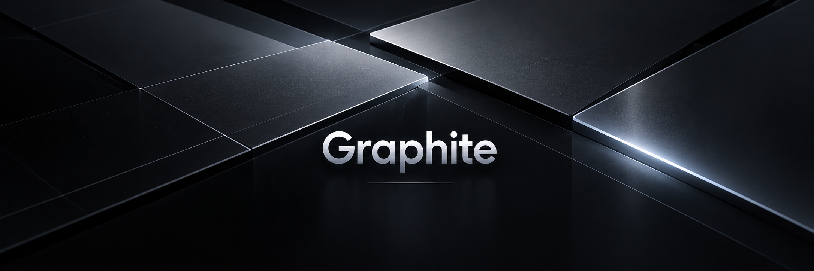

  

  <strong>Precision in every pixel.</strong>

Graphite is the visual design system for Rebuntu Desktop.

It provides a coherent foundation for desktop appearance,
theming, typography, surfaces, window decorations,
and visual consistency across the environment.
